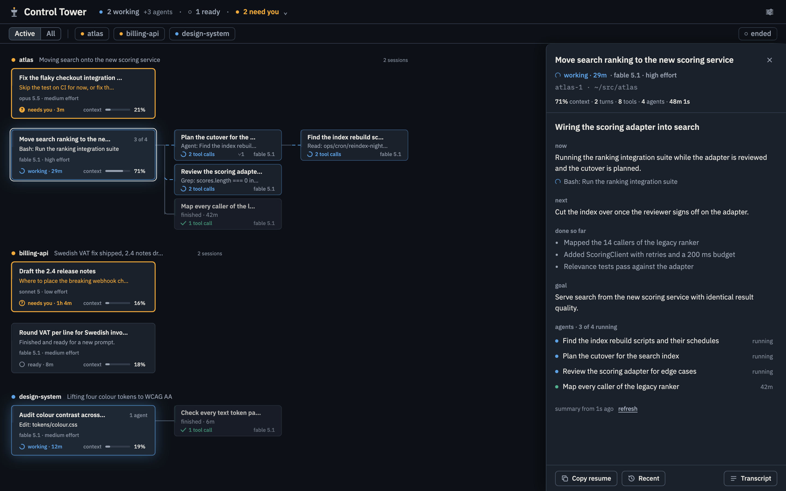
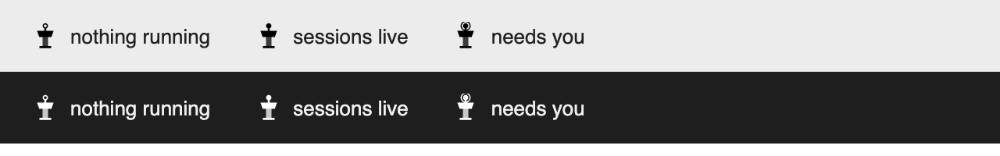

# Mac app

Control Tower as a desktop app: the server built in, the dashboard in its own window, and a tower in the menu bar that shows the fleet at a glance. No terminal needed, and it can start at login.

## Install

```sh
cd app && npm install      # downloads Electron (about 100 MB), one time
npm run install-app        # builds Control Tower.app and copies it to /Applications
```

Then open Control Tower from Applications. The build is unsigned, so it is meant for the machine it was built on. `npm start` in `app/` runs it from source instead, and `npm run icon` regenerates the menu bar icons.

## The window

The app opens the dashboard in a window on launch. It is the same page as in the browser, see [Using the page](using-the-page.md).



It behaves like any Mac app: closing the window keeps the app running, and the Dock icon, ⌘-Tab or the menu bar tower bring the window back. ⌘Q quits.

## First run: hooks

Installing the app does not install the [hooks](hooks.md), which give exact "needs you" and "finished" signals. When they are missing the app asks on launch: "Install hooks" adds them, "Later" asks again next time, and "Do not remind me again" stops the dialog. The menu bar menu keeps an "Install Claude Code hooks…" item until they are installed, whichever you chose. The hooks go into the config dir the app is watching, next to any hooks you already have.

## The menu bar tower

The icon is the tower. Menu bar icons are monochrome, so the beacon on top carries the state in shape:



| Beacon | Meaning |
|---|---|
| hollow | No session is running |
| filled | Sessions are alive |
| halo ring | Something needs you |

Next to it, a short title: `2 need you`, or `1 working · 2 agents`, or nothing when the fleet is idle.

Click the tower to show or hide the window. Its menu lists the sessions that need you, or the live sessions when nothing does, each opening the dashboard on that session. It also has "Install Claude Code hooks…" while they are missing, the summaries mode (automatic, on request, off), "Open in browser", and two toggles:

- **Start at login.** Registers the app as a login item.
- **Menu bar only.** Removes the Dock icon while the window is hidden, for a pure menu bar presence. Remembered across launches.

## The server

The app embeds the same server the CLI runs. If a `control-tower` server is already listening on the port (4747, or `PORT`) the app attaches to it instead of starting its own, so a server started from a terminal keeps serving. Quit and relaunch the app to pick up a new build of the server.

GUI apps get a minimal environment, so the app reads PATH and `CLAUDE_CONFIG_DIR` from your login shell at launch. That is how `claude` resolves for [summaries](summaries.md) when the app is started from the Dock, and how a non-default config dir is found.
