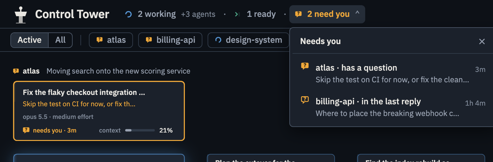
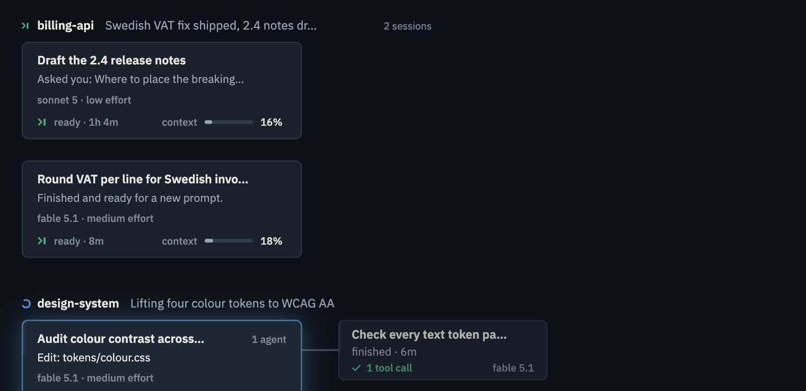
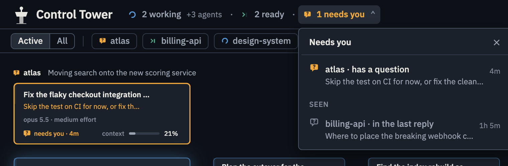
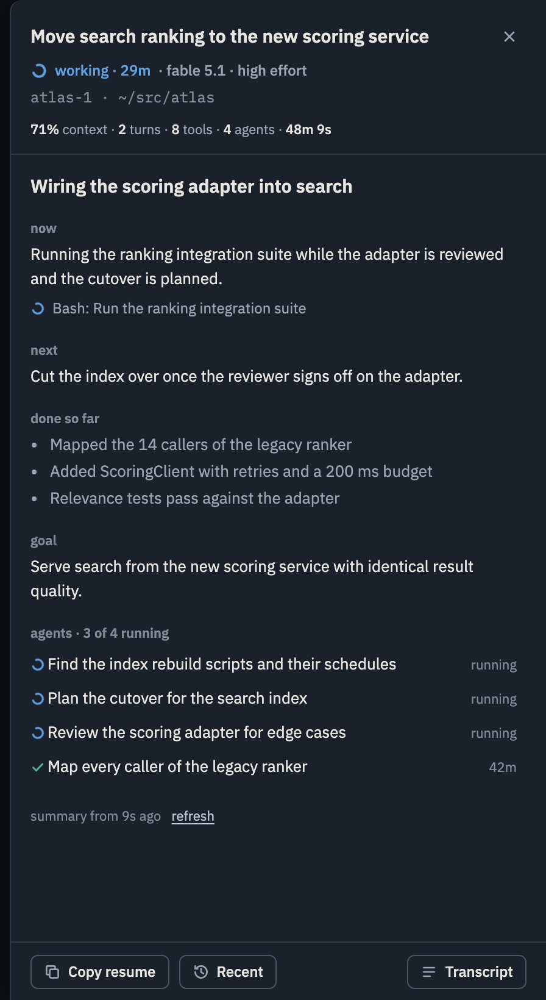
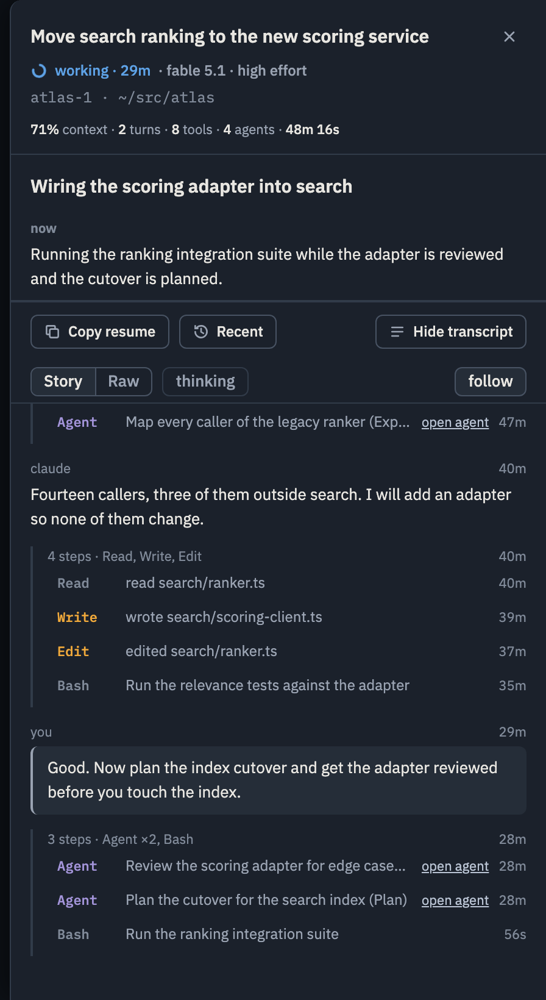
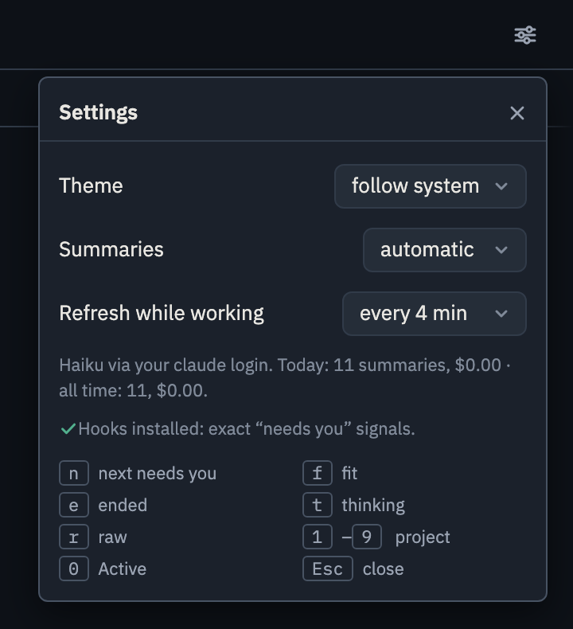
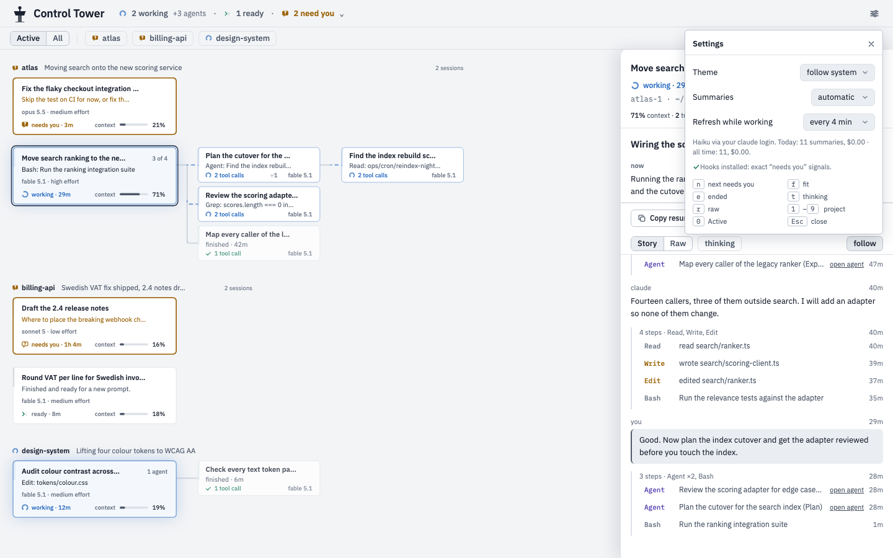
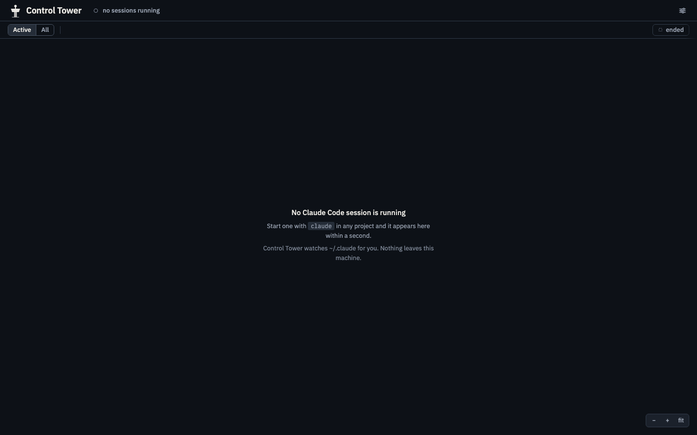

# Using the app

This is the same whether you run Control Tower from the terminal and open it in a browser, or as the Mac app. It is one screen: a status line on top, a project filter under it, and the graph. Click a node and a drawer slides in from the right. Nothing ever asks for your attention outside this screen.

## The four states

Every session is in exactly one of these, derived from the transcript, Claude Code's own busy flag and, when installed, the [hooks](hooks.md):

| State | Symbol | Motion | Meaning |
|---|---|---|---|
| Working | an arc, blue | spins | The session or one of its agents is running. The node shows the current tool call. |
| Needs you | a speech bubble with `?` (question), a padlock (permission), a hollow bubble (the last reply asked you something), amber | nudges up by a pixel every few seconds, until seen | Something waits for you; see below. |
| Ready | `›` with a cursor bar, grey | the cursor blinks slowly | The turn ended and the session is waiting for a new prompt. The node shows where it stands. |
| Ended | a dashed square, dim | none | The process is gone. Hidden unless you turn on "ended" or open the session from the recent list. |

The same symbols appear on the nodes, on the project labels and chips, in the status line, in the needs-you list and in the drawer, so you never have to remember which colour means what. Agents use the arc while running, a `✓` when finished, the dashed square when ended.

There is deliberately no "finished" for sessions: a model reading one reply cannot know whether you intend to continue. Agents do read finished, because that is a fact.

## The graph

Each session is a node under its project's label, with the project's one-line headline of what it is working on. Agents branch to the right of the session that spawned them, and an agent's own agents branch off it. Running agents come first, the three most recently finished follow, and the rest fold into one "N more" node.

Sessions keep the order they first appeared in. A state change changes a node's colour, never its position, so nothing jumps while you are looking at it.

A session node carries its title, what it is doing right now (or where it stands, when ready), model and effort, its state with how long it has been in it, and how much of the context window is used. An agent node carries its task, its current tool call, tool calls so far, and the model.

## The tab icon

In a browser, the tab icon is the tower with its beacon in the fleet's colour, so a background tab tells you whether anything is flying: hollow when no session runs, grey when all are ready, blue while something works, amber when something needs you. The tab title carries the unseen count. In the app itself the mark is just a logo; if the connection to the server is lost it dims and says so on hover.

## Needs you, and seen

The status line counts the sessions that need you. Click the count, or press `n`, for the list: each item names the project, the reason and how long it has waited. New items flash once, nodes that need you get an amber ring, and a quiet toast appears when a session turns to you.

Two kinds of item behave differently:

- **Blocking prompts.** A question dialog (the filled bubble) or a permission request (the padlock) has the terminal stuck. These count until you answer them in the terminal. Looking at them only stops the pulse.
- **Follow-ups.** The hollow bubble: the [summarizer](summaries.md) judged that the last reply cannot proceed without you, because it ended with a direct question or asked for a choice or an approval. These are notifications. Once you have looked at one, by opening the session, clicking its row or toast, or picking its project, it leaves the count, its node goes back to grey with an "Asked you: …" line, and it waits under a "seen" divider in the list so you can come back to it. If the session asks something new later, it is unseen again.

Unseen follow-ups keep their project in the Active filter however old they are. A session you started and walked away from does not quietly get lost.

## The drawer

Click a node and the drawer opens over the right edge without reflowing the graph. It leads with the summary: a headline, what is happening now, what comes next, what is done so far, the goal, and the agents with their state. The summary refreshes every few minutes while the session works. Under the title: state and how long, model and effort, the session's name and directory, then context used, turns, tool calls, agents and running time.

The transcript is one button away. The story view shows your prompts and Claude's replies in full, with the tool work folded into one line per step; an agent's step links to that agent's own transcript. Press `r` for the raw log and `t` to show thinking. The transcript follows new lines as they arrive; scroll up to stop following, press `f` or the follow button to follow again. "Load earlier" at the top pages back through long sessions.

"Copy resume" puts `cd <dir> && claude --resume <id>` on the clipboard. "Recent" lists the project's earlier sessions, so a finished one can be reopened in the terminal or read here.

Click the node again or press `Esc` to close.

## Project filter

The row under the status line lists projects. **Active**, the default, shows projects with something going on, an unseen follow-up, or activity in the last hour. **All** shows everything. Click a project name for just that one, shift-click to add another. The dot next to a name is the project's worst state. **Ended** on the right toggles ended sessions.

## Settings

The ⚙ in the top right opens settings: theme (follow the system, light or dark), the summaries mode and refresh interval, what summaries have cost, whether hooks are installed with a one-click install, and the keyboard reference.

The light theme follows the system by default:

## Nothing running

With no live session the app says so and tells you how to start one.

## Keys

| Key | Action |
|---|---|
| `n` | Open the next session that needs you |
| `f` | Fit the graph, or toggle follow when the transcript is open |
| `Esc` | Close the popover, then the drawer |
| `+` `-` | Zoom |
| `r` | Raw transcript |
| `t` | Show thinking |
| `e` | Toggle ended sessions |
| `1` to `9`, `0` | Pick the nth project, back to Active |

Double-click empty canvas to fit. Drag to pan, ⌘-wheel or ctrl-wheel to zoom.
